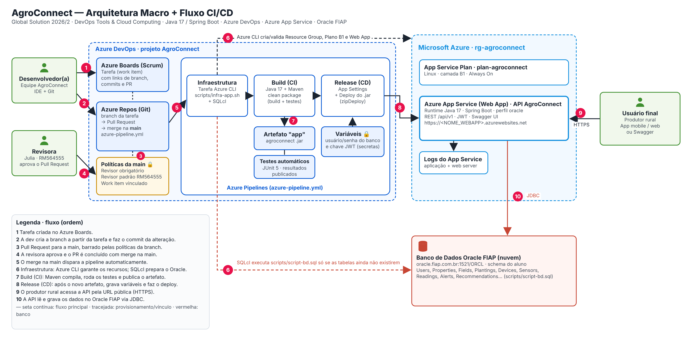

# AgroConnect

**Global Solution 2026/2 · DevOps Tools & Cloud Computing**

## 1. Descrição da solução

O **AgroConnect** é uma API REST em Java 17 com Spring Boot que apoia **pequenos produtores rurais** no acompanhamento de hortas e plantações.

- O produtor cadastra suas **propriedades** e divide cada uma em **talhões** (canteiros ou áreas de cultivo).
- Em cada talhão, ele registra **plantios** e instala **dispositivos IoT** com **sensores** de umidade do solo, temperatura, luminosidade, chuva etc.
- As **leituras** dos sensores geram **alertas** quando algo foge do ideal (por exemplo, solo seco). A API também guarda o histórico e as recomendações de manejo.
- Cada conta acessa somente os próprios dados. A autenticação é feita com **JWT**.

### Benefícios para o negócio

- **Decisão baseada em dados:** o produtor deixa de depender só da observação visual e acompanha umidade, temperatura e chuva por talhão.
- **Menos perda de safra e de água:** os alertas avisam cedo sobre solo seco, excesso de chuva ou falha de sensor, e a irrigação passa a ser feita na hora certa.
- **Organização da produção:** propriedades, talhões e plantios ficam registrados em um só lugar, com histórico.
- **Acesso de qualquer lugar:** a API está publicada na nuvem e atende o aplicativo mobile e a versão web.
- **Entrega contínua:** cada melhoria aprovada no Pull Request chega aos usuários automaticamente, com testes executados antes de qualquer deploy.

### Stack de tecnologias

| Camada | Tecnologias |
|---|---|
| Aplicação | Java 17, Spring Boot, Spring Web, Spring Data JPA, Spring Security (JWT), Bean Validation, springdoc-openapi (Swagger), Maven |
| Testes automáticos | JUnit 5 + Spring Boot Test + MockMvc (`agroconnect/src/test`), com banco H2 em memória nos testes, executados no CI |
| Banco de dados em nuvem | **Oracle Database da FIAP** (`oracle.fiap.com.br`), driver `ojdbc11` |
| Nuvem | Microsoft Azure: Resource Group, App Service Plan (Linux B1, Always On), **Azure App Service** (Java 17), Logs do App Service |
| DevOps | **Azure DevOps**: Boards (Scrum), Repos (Git, branch `main` protegida), Pipelines (YAML multi-stage), Service Connection `MyAzureSubscription` |
| Infra como código | Azure CLI + SQLcl em `scripts/infra-app.sh` |

## 2. Arquitetura macro + fluxo CI/CD



| # | Etapa | Ferramenta |
|---|---|---|
| 1 | Criação da tarefa (work item) | Azure Boards |
| 2 | Criação da branch a partir da tarefa e commit da alteração | Azure Repos + IDE |
| 3 | Pull Request para a `main`, validado pelas políticas da branch | Azure Repos (Branch policies) |
| 4 | Aprovação pela revisora (RM564555) e merge na `main` | Azure Repos |
| 5 | O merge na `main` dispara a pipeline automaticamente | Azure Pipelines (trigger) |
| 6 | **Infraestrutura:** cria/valida o Resource Group, o Plano e o Web App e prepara as tabelas no Oracle (somente se não existirem) | Azure CLI + SQLcl (`scripts/infra-app.sh`) |
| 7 | **Build (CI):** compila, executa os testes automáticos e publica o `.jar` como artefato `app` | Maven + JUnit 5 |
| 8 | **Release (CD):** depois do novo artefato, grava as variáveis protegidas no Web App e faz o deploy | AzureAppServiceSettings + AzureWebApp (zipDeploy) |
| 9 | O produtor rural acessa a API pela URL pública | Azure App Service (HTTPS) |
| 10 | A API lê e grava os dados no banco | JDBC → Oracle FIAP |

**Personas:** Desenvolvedor(a) da equipe, Revisora (aprova o Pull Request) e Usuário final (produtor rural, via aplicativo ou Swagger).

## 3. Componentes do repositório

O AgroConnect foi construído em três projetos Maven independentes:

| Projeto | Responsabilidade | Na nuvem (GS DevOps) |
|---|---|---|
| `agroconnect` | **API REST principal:** autenticação, CRUDs, alertas e persistência no Oracle | **Sim**, publicada no Azure App Service |
| `agroconnect-ia` | Serviço de recomendações com Spring AI (OpenAI) | Não publicado |
| `servidor-eureka` | Registro e descoberta de serviços (Eureka) | Não publicado |

Nesta entrega a API roda com o perfil `oracle`, em modo autônomo, sem Eureka. Todos os CRUDs funcionam normalmente. As recomendações por IA dependem do serviço `agroconnect-ia` e de uma chave OpenAI, por isso não foram publicadas na nuvem.

### Por que o plano B1

A API foi publicada no plano **Basic B1** (Linux), e não no gratuito F1:

- **Computação dedicada:** o F1 roda em infraestrutura compartilhada, com limite de 60 minutos de CPU por dia. Uma API Spring Boot com segurança, documentação e acesso a banco consome boa parte disso só para iniciar, e a cada deploy da pipeline ela reinicia.
- **Always On:** no B1, a API fica sempre carregada. No F1 ela é descarregada depois de um período sem uso, e o produtor esperaria a aplicação "acordar" na primeira requisição.
- **Entrega contínua sem interrupção:** vários merges no mesmo dia geram vários deploys. No B1 isso não esgota cota nem tira a API do ar.
- **Custo baixo e controlado:** cerca de US$ 0,02 por hora, coberto pelos créditos da assinatura. O grupo de recursos pode ser removido ao fim da avaliação.

## 4. Banco de dados em nuvem

Foi utilizado o **Banco Oracle da FIAP**. O arquivo **`scripts/script-bd.sql`** contém:

1. Remoção de objetos e tabelas (para uma reinstalação limpa).
2. DDL das 19 tabelas do domínio (`Users`, `Properties`, `Fields`, `Plantings`, `Devices`, `Sensors`, `Readings`, `Alerts`, `Recommendations`, `Crops`...).
3. Índices, pacotes PL/SQL e triggers.
4. Carga inicial de dados de demonstração.

O estágio **Infraestrutura** da pipeline executa esse script automaticamente **apenas quando a tabela `PROPERTIES` ainda não existe** no schema. Assim, as execuções seguintes da pipeline **não apagam** os dados gravados pela API.

## 5. Projeto no Azure DevOps

| Campo | Valor |
|---|---|
| Project name | `AgroConnect` |
| Visibility | **Private** |
| Version control | **Git** |
| Work item process | **Scrum** |
| Professor | Organização: **Basic** · Projeto: **Project Administrators** |

### Políticas da branch `main` (Repos → Branches → main → Branch policies)

| Política | Configuração |
|---|---|
| Require a minimum number of reviewers | **1**, com **Allow requestors to approve their own changes** marcado |
| Check for linked work items | **Required** |
| Automatically included reviewers | **Julia Sayuri Kina (RM564555)**, como **Required** |

Com essas políticas, a `main` não aceita push direto: toda alteração entra por Pull Request vinculado a uma tarefa do Boards.

## 6. Pipeline CI/CD (`azure-pipeline.yml`)

A pipeline é **YAML multi-stage** e fica versionada na raiz do repositório.

```text
trigger: main   (somente após o merge do Pull Request)   ·   pr: none
   │
   ├─ Stage 1: Infraestrutura  → AzureCLI@2 executa scripts/infra-app.sh
   ├─ Stage 2: Build (CI)      → JavaToolInstaller@0 → Maven@4 (clean package + testes JUnit)
   │                             → CopyFiles@2 → PublishPipelineArtifact@1 (artefato "app")
   └─ Stage 3: Release (CD)    → DownloadPipelineArtifact@2 → AzureAppServiceSettings@1
                                 → AzureWebApp@1 (webAppLinux, zipDeploy)
```

### Variáveis da pipeline (Pipelines → Edit → Variables)

| Nome | Exemplo de valor |
|---|---|
| `NOME_WEBAPP` | `agroconnect-rm564555` |
| `LOCATION` | `brazilsouth` |
| `ORACLE_HOST` | `oracle.fiap.com.br` |
| `ORACLE_PORT` | `1521` |
| `ORACLE_SID` | `ORCL` |
| `ORACLE_USER` | usuário Oracle |
| `ORACLE_PASS` | senha Oracle |
| `JWT_KEY` | chave aleatória com 32+ caracteres |

Nenhuma senha fica no código-fonte. No estágio Release, os valores são gravados no Web App como `ORACLE_URL`, `ORACLE_USERNAME`, `ORACLE_PASSWORD` e `JWT_KEY`. A aplicação os lê pelo `application-oracle.properties`:

```properties
spring.datasource.url=${ORACLE_URL}
spring.datasource.username=${ORACLE_USERNAME}
spring.datasource.password=${ORACLE_PASSWORD}
```

## 7. How To: deploy e teste

### 7.1 Pré-requisitos

- Organização no Azure DevOps e assinatura do Azure.
- Usuário e senha do Oracle FIAP.

### 7.2 Repositório e conexão com o Azure

1. **Repos → Import a repository:** cole a URL deste repositório.
2. **Project settings → Service connections → New → Azure Resource Manager:**
   - Scope: **Subscription**
   - Nome: **`MyAzureSubscription`**
   - Marque **Grant access permission to all pipelines**.

### 7.3 Pipeline

1. **Pipelines → Create Pipeline → Azure Repos Git → (repositório) → Existing Azure Pipelines YAML file → `/azure-pipeline.yml`.**
2. Cadastre as variáveis da seção 6. As três sensíveis vão como **Keep this value secret**.
3. Clique em **Run**.

### 7.4 Fluxo de alteração (Boards → Repos → Pipelines)

1. **Boards:** crie uma Task.
2. Na tarefa, use **Create a branch** para criar uma branch vinculada a ela.
3. Altere o código nessa branch e faça o commit.
4. **Repos → Pull requests → New**, da branch para a `main`, com a tarefa vinculada.
5. Aprove o PR e clique em **Complete**: o merge é feito e a tarefa é concluída.
6. A pipeline dispara sozinha: Infraestrutura → Build (CI) → Release (CD).

### 7.5 Validar

- **Pipeline:** os 3 estágios verdes. Em **Tests**, 100% passed. Em **Related**, `1 published` (artefato `app`).
- **Portal Azure:** `rg-agroconnect` → Web App → Visão geral → **Domínio padrão**.
- **Swagger:** `https://<NOME_WEBAPP>.azurewebsites.net/swagger-ui/index.html`
- **Saúde da API:** `https://<NOME_WEBAPP>.azurewebsites.net/actuator/health`

## 8. CRUD em JSON (Propriedades e Talhões)

Todas as rotas abaixo partem da URL publicada (`https://<NOME_WEBAPP>.azurewebsites.net`). As rotas protegidas exigem o cabeçalho:

```http
Authorization: Bearer <accessToken>
```

No Swagger, clique em **Authorize** e cole o `accessToken`.

### 8.1 Autenticação

**Cadastrar conta:** `POST /api/v1/auth/register`

```json
{
  "name": "Produtor AgroConnect",
  "email": "produtor@agroconnect.test",
  "password": "SenhaDeExemplo123!"
}
```

**Login:** `POST /api/v1/auth/login`

```json
{
  "email": "produtor@agroconnect.test",
  "password": "SenhaDeExemplo123!"
}
```

A resposta traz o `accessToken`, que vale por 1 hora.

### 8.2 Propriedades (tabela `PROPERTIES`)

| Operação | Método e rota |
|---|---|
| Create | `POST /api/v1/properties` |
| Read (lista) | `GET /api/v1/properties` |
| Read (uma) | `GET /api/v1/properties/{id}` |
| Update | `PATCH /api/v1/properties/{id}` |
| Delete | `DELETE /api/v1/properties/{id}` |

**Create:**

```json
{
  "name": "Sítio Primavera",
  "city": "São Paulo",
  "state": "SP",
  "areaHectares": 1.5,
  "description": "Área destinada ao cultivo de hortaliças."
}
```

**Update** (somente os campos enviados são alterados):

```json
{
  "name": "Sítio Primavera Orgânico",
  "areaHectares": 2.0
}
```

### 8.3 Talhões (tabela `FIELDS`, relacionada a `PROPERTIES`)

| Operação | Método e rota |
|---|---|
| Create | `POST /api/v1/properties/{propertyId}/fields` |
| Read (lista) | `GET /api/v1/properties/{propertyId}/fields` |
| Read (um) | `GET /api/v1/fields/{id}` |
| Update | `PUT /api/v1/fields/{id}` |
| Delete | `DELETE /api/v1/fields/{id}` |

**Create:**

```json
{
  "name": "Canteiro 01",
  "areaHectares": 0.2
}
```

**Update:**

```json
{
  "name": "Canteiro 01 - Alface",
  "areaHectares": 0.25
}
```

As demais rotas (plantios, dispositivos, sensores, leituras, alertas, culturas...) estão documentadas no Swagger.

### 8.4 Conferência no banco (SELECT)

```sql
SELECT RAWTOHEX(Id) AS id, Name, City, State, AreaHectares, UpdatedAt
  FROM Properties
 ORDER BY CreatedAt DESC;

SELECT RAWTOHEX(f.Id) AS id, f.Name, f.AreaHectares, p.Name AS propriedade
  FROM Fields f
  JOIN Properties p ON p.Id = f.PropertyId
 ORDER BY p.CreatedAt DESC;
```

## 9. Testes automáticos

Os testes ficam em `agroconnect/src/test` (JUnit 5 + Spring Boot Test + MockMvc). Eles cobrem:

- Autenticação.
- CRUDs do domínio.
- Idempotência.
- Documentação Swagger.
- Persistência com a estrutura Oracle.

No CI, eles rodam sobre um banco **H2 em memória**, sem depender do Oracle. Os resultados são publicados na aba **Tests** da execução.

Para rodar localmente:

```bash
cd agroconnect
./mvnw test
```

## 10. Estrutura do repositório

```text
agroconnect-devops/
├── azure-pipeline.yml          # Pipeline CI/CD (Infraestrutura, Build e Release)
├── scripts/
│   ├── infra-app.sh            # Azure CLI (RG, Plano, Web App, logs) + SQLcl (banco)
│   └── script-bd.sql           # DDL e carga inicial do Oracle
├── docs/
│   └── arquitetura-agroconnect.png
├── agroconnect/                # API REST publicada no Azure App Service
├── agroconnect-ia/             # Serviço de IA (não publicado nesta entrega)
└── servidor-eureka/            # Eureka (não publicado nesta entrega)
```

## 11. Integrantes

| Nome | RM | Turma |
|---|---|---|
| Carolina Nascimento Gonçalves | 564786 | 2TDSPI |
| Emanuelly Ventura do Nascimento | 562339 | 2TDSPI |
| Julia Sayuri Kina | 564555 | 2TDSPI |
| Rafael de Freitas Moraes | 563210 | 2TDSPI |
| Rafael Pascotte Mercadante | 564928 | 2TDSPI |

## 12. Links

- Vídeo de demonstração (GS DevOps): _x_
- Organização no Azure DevOps: _x_
